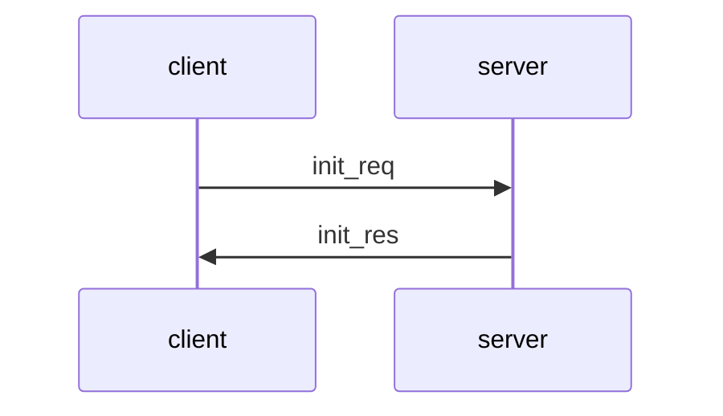

# Simple File Transfer v0.7

This document specifies version 0.7 of the Simple File Transfer (SiFT) protocol. SiFT can be used by a client to send file commands to a server, which executes those commands. SiFT supports the following 7 commands (same as for SiFT v0.5 and v0.6):

- __pwd__ --> Print current working directory: Returns to the client the name of the current working directory on the server.
- __lst__ --> List content of the current working directory: Returns to the client the list of files and directories in the current working directory on the server. 
- __chd__ --> Change directory: Changes the current working directory on the server. The name of the target directory is provided as an argument to the chd command.
- __mkd__ --> Make directory: Creates a new directory on the server. The name of the directory to be created is provided as an argument to the mkd command.
- __del__ --> Delete file or directory: Deletes a file or a directory on the server. The name of the file or directory to be deleted is provided as an argument to the del command.
- __upl__ --> Upload file: Uploads a file from the client to the server. The name of the file to be uploaded is provided as an argument to the upl command and the file is put in the current working directory on the server.
- __dnl__ --> Download file: Downloads a file from the current working directory of the server to the client. The name of the file to be downloaded is provided as an argument to the dnl command.

SiFT allows the client and the server to communicate via a network and execute the above commands remotely. It assumes that the client and the server uses the TCP/IP protocol to establish a connection and to send data reliably to each other. By reliability, we mean that the bytes sent by a party arrive to the other party, and they arrive in the order that they were sent. The SiFT v0.7 server must listen and accept client connection requests on TCP port 5150.

SiFT v0.6 protected its messages with AES-GCM, but it used a static (hard coded) key, which offers no real protection. SiFT v0.7 fixes this weakness by adding a new sub-protocol, the Init Protocol, which runs right after the TCP connection is established. The Init Protocol (i) establishes a fresh shared secret between the client and the server, (ii) derives a 32-byte AES key from this shared secret, and (iii) passes the derived key to the Message Transfer Protocol, which uses it to protect all subsequent messages of the connection. The static key of SiFT v0.6 is no longer used.

## Overview of sub-protocols

SiFT v0.7 has the following sub-protocols: Message Transfer Protocol (MTP), Init Protocol, Login Protocol, Commands Protocol, Upload Protocol, and Download Protocol. The following figure shows how these sub-protocols are related to each other: 

```
  +-------------+ +--------------+ +-----------------+ +---------------+ +-----------------+
  |Init Protocol| |Login Protocol| |Commands Protocol| |Upload Protocol| |Download Protocol|
  +-------------+ +--------------+ +-----------------+ +---------------+ +-----------------+
  +---------------------------------------------------------------------------------------+
  |                           Message Transfer Protocol (MTP)                             |
  +---------------------------------------------------------------------------------------+
```

SiFT v0.7 messages are carried by the Message Transfer Protocol (MTP). The Init Protocol is executed first, right after the establishment of the TCP connection. Its messages are carried by MTP without cryptographic protection by MTP, because no shared key exists yet; they are protected by the Init Protocol itself (see below). At the end of the Init Protocol, both parties hand over the freshly derived key to MTP. From that point on, MTP encrypts and integrity protects every message with AES-GCM using this key.

After the Init Protocol, the Login Protocol is used to authenticate the client to the server via a username / password mechanism. After the Login Protocol, the Commands Protocol is used to send file commands of the client to the server and responses to those commands. Moreover, the upload command is followed by the execution of the Upload Protocol, which is responsible for the actual upload of the selected file to the server, and the download command is followed by the execution of the Download Protocol, which is responsible for the actual download of the selected file from the server. All messages of the Login, Commands, Upload, and Download Protocols are cryptographically protected by MTP with the key established by the Init Protocol.

## Security goals and assumptions

### Attacker model

We assume an active network attacker who can read, modify, delete, reorder, replay, and inject any message on the network between the client and the server. The attacker can also open connections to the server and act as a client, and it can try to impersonate the server towards a client. We further assume that the attacker may obtain the long-term private key of the server at some point in the future (e.g., by compromising the server or a backup of it). The attacker cannot break the cryptographic primitives used (X25519, Ed25519, SHA-256, HKDF, AES-GCM) and does not control the client or server computers during a session.

### Server key

The server has a long-term Ed25519 key pair. The public key is denoted by PK_srv and the private key by SK_srv. PK_srv is used only for signing the server's Init Protocol messages; it is not used for encryption or key agreement. SK_srv must be stored on the server in encrypted form, protected by a passphrase (see _Key storage_ below).

The client does not need to know PK_srv in advance: the server sends it to the client in the Init Protocol. The client displays the SHA-256 hash of PK_srv (the _fingerprint_ of the server key) to the user, who accepts or rejects the key by comparing the fingerprint with the expected value obtained via a trusted channel (e.g., printed by the server operator or published on a trusted web page).

### Security goals

The Init Protocol must achieve the following goals:

1. __Secrecy of the session key__: Only the client and the server learn the derived MTP key. A passive or active network attacker learns nothing about it, provided that the user accepted PK_srv only after checking its fingerprint correctly.
2. __Server authentication__: The client gets assurance that the party it shares the key with holds SK_srv (i.e., is the genuine server). This is needed because otherwise a man-in-the-middle could run the Init Protocol separately with both parties and read the password sent in the Login Protocol.
3. __Key freshness__: Every connection gets a new key that is independent of the keys of all other connections. Both parties contribute fresh randomness, so that neither party can be forced (e.g., by a replay) to reuse an old key.
4. __Forward secrecy__: Compromise of SK_srv does not reveal the keys of past connections, so recorded traffic (including passwords and files) stays confidential. This is the main reason for using ephemeral Diffie-Hellman instead of encrypting a secret with the server's public key.
5. __Integrity of the handshake__: The attacker cannot modify any Init Protocol message without being detected, so it cannot, for instance, replace the client's ephemeral public key or the server key sent to the client.
6. __Key confirmation__: Both parties get assurance that the other party has derived the same key. In SiFT v0.7 this is implicit: the first AES-GCM protected messages (login request and login response) can only be verified with the correct key (see _Key confirmation_ below).

Client authentication is not a goal of the Init Protocol. The client still authenticates itself to the server with the username/password mechanism of the Login Protocol. Because the login request is sent only after the server was authenticated and the key was established, the password is protected against both passive and active attackers.

### Non-goals and limitations

- The security of the protocol relies on the user comparing the displayed fingerprint with the correct value. If the user accepts a fingerprint without checking it, a man-in-the-middle attack is possible.
- The protocol does not protect against denial-of-service attacks. An unauthenticated client can make the server perform a key generation, a signature, and a Diffie-Hellman computation; these are cheap operations for X25519 and Ed25519.
- The protocol does not hide that a SiFT connection takes place, nor the length and timing of the messages.
- The protocol does not support rekeying. A connection is limited to 65535 messages per direction by the 2-byte sequence number; after that, the connection must be closed and a new one (with a new Init Protocol run) must be opened.
- The protocol is not secure against attackers with a large quantum computer.

### Design rationale

The following alternatives were considered for establishing the shared secret:

- __Key transport with the server's public key__ (e.g., the client encrypts a random secret with an RSA-OAEP PK_srv): simple and authenticates the server implicitly, but it provides no forward secrecy. Anyone who obtains SK_srv later can decrypt all recorded sessions. Rejected.
- __Unauthenticated (anonymous) Diffie-Hellman__: provides forward secrecy against passive attackers, but a man-in-the-middle can establish separate keys with both parties. Rejected.
- __Ephemeral Diffie-Hellman signed with the server's long-term key__ (chosen): provides forward secrecy and server authentication. This is the same approach as the server-authenticated handshake of TLS 1.3. X25519 and Ed25519 are chosen because they are fast, have fixed-size keys and signatures (which keeps the message format simple), and are widely supported.

## SiFT v0.7 Message Transfer Protocol 

The SiFT v0.7 Message Transfer Protocol (MTP) is the same as the SiFT v0.6 MTP with the following differences:
- the version number is `00 07`,
- there are two new message types for the Init Protocol,
- the Init Protocol messages are not encrypted and do not have a mac field,
- the AES-GCM key is not static, but it is the key provided by the Init Protocol.

### Message formats

SiFT v0.7 MTP messages, except for the Init Protocol messages, have the following format (same as in SiFT v0.6):

```
	+---+---+---+---+---+---+---+---+---+---+---+---+---+---+---+---+
	|  ver  |  typ  |  len  |  sqn  |          rnd          |  rsv  |
	+---+---+---+---+---+---+---+---+---+---+---+---+---+---+---+---+
	|                                                               |
	+                                                               +
	|                                                               |
	.                                                               .
	.                    encrypted payload (epd)                    .
	.                                                               .
	|                                                               |
	+                                                               +
	|                                                               |
	+               +---+---+---+---+---+---+---+---+---+---+---+---+
	|               |                      mac                      |
	+---+---+---+---+---+---+---+---+---+---+---+---+---+---+---+---+
```

The Init Protocol messages (MTP types `04 00` and `04 10`) have the following format, where the payload is not encrypted and there is no mac field:

```
	+---+---+---+---+---+---+---+---+---+---+---+---+---+---+---+---+
	|  ver  |  typ  |  len  |  sqn  |          rnd          |  rsv  |
	+---+---+---+---+---+---+---+---+---+---+---+---+---+---+---+---+
	|                                                               |
	+                                                               +
	|                                                               |
	.                                                               .
	.                            payload                            .
	.                                                               .
	|                                                               |
	+                                                               +
	|                                                               |
	+---+---+---+---+---+---+---+---+---+---+---+---+---+---+---+---+
```

SiFT v0.7 MTP messages have a 16-byte header that consists of the following fields:

- __ver__: A 2-byte _version number_ field, where the first byte is the major version (i.e., 0 in case of v0.7) and the second byte is the minor version (i.e., 7 in case of v0.7). This means that messages conforming this specification must start with the byte sequence `00 07`.
- __typ__: A 2-byte _message type_ field that specifies the type of the payload in the message. The following message types are supported by SiFT v0.7:
	- `00 00` : _login_req_ (login request)
	- `00 10` : _login_res_ (login response)
	- `01 00` : _command_req_ (command request)
	- `01 10` : _command_res_ (command response)
	- `02 00` : _upload_req_0_ (upload request containing a file fragment)
	- `02 01` : _upload_req_1_ (upload request containing the last file fragment)
	- `02 10` : _upload_res_ (upload response)
	- `03 00` : _dnload_req_ (download request)
	- `03 10` : _dnload_res_0_ (download response containing a file fragment)
	- `03 11` : _dnload_res_1_ (download response containing the last file fragment)
	- `04 00` : _init_req_ (init request)
	- `04 10` : _init_res_ (init response)
- __len__: A 2-byte _message length_ field that contains the length of the entire message (including the header) in bytes (using big endian byte order).
- __sqn__: A 2-byte _message sequence number_ field that contains the sequence number of this message (using big endian byte order).
- __rnd__: A 6-byte _random_ field that contains freshly generated random bytes.
- __rsv__: A 2-byte _reserved_ field which is not used in this version of the protocol (reserved for future versions). The value of this field in messages conforming this specification should be `00 00`.

The values for the message types are defined according to the same concept as in SiFT v0.6, with `04` in the first byte encoding the init interaction.

For all message types except _init_req_ and _init_res_, the header is followed by the AES-GCM encrypted payload (__epd__) and the AES-GCM authentication tag (__mac__). The mac field in this version of the protocol must be 12 bytes long. The len field is the sum of the length of the header (16), the length of the encrypted payload (same as the length of the payload), and the length of the mac field (12).

For the _init_req_ and _init_res_ message types, the header is followed by the payload in cleartext, and there is no mac field. The len field is the sum of the length of the header (16) and the length of the payload.

### Processing

Each party maintains a sending sequence number and a receiving sequence number, both set to 0 when the TCP connection is established. Sequence numbers are counted across the whole connection, including the Init Protocol messages: they are not reset when the key is installed. Each party also stores the MTP key, which is initially unset.

When a TCP connection is established by the client to the server, the first message the client must send is an init request (type `04 00`) and the server must respond with an init response (type `04 10`). Both messages are sent with sqn = `00 01`, a fresh 6-byte random value in the rnd field, and rsv = `00 00`. Their payloads are sent in cleartext without a mac field. The integrity of these messages is protected by the Init Protocol (see below), and not by MTP.

While the MTP key is unset, MTP must only send and accept messages of type _init_req_ and _init_res_, and a received message must have sqn = `00 01`. Once the Init Protocol has completed, it hands over the derived 32-byte key to MTP, which stores it. From that point on, MTP must not send or accept _init_req_ or _init_res_ messages anymore, and all other messages are processed exactly as in SiFT v0.6, except that the stored key is used instead of the static all-zero key:
- the message header is produced with the appropriate message type (depending on the payload to be sent), the appropriate length, the next sending sequence number, and a fresh 6-byte random value, 
- the encrypted payload and the mac fields are produced by processing the message header and the payload with AES in GCM mode using the stored key and the nonce sqn+rnd (here + means concatenation of byte strings), where the message header is the associated data,
- the message is sent and the incremented sending sequence number is stored (as the sequence number of the last message sent).

Consequently, the login request is the second message sent by the client (sqn = `00 02`), and the login response is the second message sent by the server (sqn = `00 02`).

When such an MTP message is received, the receiving party 
- verifies that the version number is `00 07`, the message type is valid in the current state, and the rsv field is `00 00`,
- verifies if the sequence number sqn in the message is larger than the last received sequence number, 
- verifies the mac and decrypts the encrypted payload with AES in GCM mode using the stored key and the nonce sqn+rnd, and
- if all verifications are successful, the stored receiving sequence number is set to the sqn value received in the message header.

The rnd field must be generated by a cryptographic random number generator. A party must not send a message with a sequence number larger than `ff ff`; when the sending sequence number is exhausted, the connection must be closed.

A message that does not pass all verifications must be silently discarded (no error message is sent in the MTP protocol) and the connection between the client and the server must be closed. Closing the connection is initiated by the receiving party that encountered the offending message.

## SiFT v0.7 Init Protocol

The SiFT v0.7 Init Protocol is responsible for establishing a fresh shared secret between the client and the server, authenticating the server to the client, deriving a 32-byte AES key from the shared secret, and passing this key to MTP. It uses an ephemeral X25519 Diffie-Hellman key exchange (RFC 7748), where the server signs its contribution with its long-term Ed25519 key (RFC 8032), and HKDF with SHA-256 (RFC 5869) for key derivation.

### Message exchange

The message exchange of the Init Protocol is shown in the figure below:



The Init Protocol consists of 2 message transfers. It must be executed right after the TCP connection is established and before any other protocol. First, the client must send an init request (init_req) to the server, and after that, the server must send an init response (init_res) to the client. If the server receives another type of message when it expects an init request, or the client receives another type of message when it expects an init response, then the connection between the client and the server must be closed. Closing the connection is initiated by the receiving party that encountered the offending message.

### Message formats

The Init Protocol is a text-based protocol, like the Login and Commands Protocols. All payloads must be encoded in UTF-8 coding in this version of the protocol (in fact, they only contain hexadecimal digits and `'\n'` characters). All binary values are encoded as lowercase hexadecimal strings. Every field has a fixed length, and a receiver must reject a message where any field has a different length or contains characters other than hexadecimal digits.

_init_req_

The format of the init request message (MTP type `04 00`) is the following:

```
<client_random>'\n'
<client_ecdh_public_key>
```

where `'\n'` is the new line character, which serves as a delimiter that separates the fields of the message. The fields are specified as follows:

- `<client_random>` is a hexadecimal number converted to a string, the value of which is a 32-byte random value freshly generated by the client using a cryptographic random number generator (64 hexadecimal digits).
- `<client_ecdh_public_key>` is a hexadecimal number converted to a string, the value of which is the client's freshly generated ephemeral X25519 public key in its raw 32-byte encoding as defined in RFC 7748 (64 hexadecimal digits).

The payload of the init request is 129 bytes long.

_init_res_

The format of the init response message (MTP type `04 10`) is the following:

```
<server_random>'\n'
<server_ecdh_public_key>'\n'
<server_public_key>'\n'
<signature>
```

where the fields are specified as follows:

- `<server_random>` is a hexadecimal number converted to a string, the value of which is a 32-byte random value freshly generated by the server using a cryptographic random number generator (64 hexadecimal digits).
- `<server_ecdh_public_key>` is a hexadecimal number converted to a string, the value of which is the server's freshly generated ephemeral X25519 public key in its raw 32-byte encoding (64 hexadecimal digits).
- `<server_public_key>` is a hexadecimal number converted to a string, the value of which is PK_srv, the server's long-term Ed25519 public key, encoded as a DER SubjectPublicKeyInfo structure (RFC 8410). This encoding is 44 bytes long (88 hexadecimal digits).
- `<signature>` is a hexadecimal number converted to a string, the value of which is the 64-byte Ed25519 signature (RFC 8032, pure Ed25519) of the server on the signed data defined below (128 hexadecimal digits).

The payload of the init response is 347 bytes long.

The _signed data_ is the concatenation of the following byte strings:

```
signed_data = "SiFT v0.7 init_res" + init_req_payload + init_res_tbs
```

where
- `"SiFT v0.7 init_res"` is the ASCII encoding of the given string (18 bytes, without quotes), which ensures that the signature cannot be confused with a signature produced by the same key for another purpose,
- `init_req_payload` is the complete payload of the init request (129 bytes), exactly as received by the server,
- `init_res_tbs` is the payload of the init response up to, but not including, the `'\n'` that precedes the `<signature>` field (i.e., `<server_random>'\n'<server_ecdh_public_key>'\n'<server_public_key>`, 218 bytes).

Since all fields have fixed lengths, this concatenation is unambiguous.

### Key derivation

Both parties compute the X25519 shared secret Z (32 bytes) from their own ephemeral private key and the peer's ephemeral public key, as specified in RFC 7748. If Z consists of 32 `00` bytes (which happens if the peer sent a low-order public key), the party must close the connection.

The MTP key is then derived with HKDF (RFC 5869) using SHA-256 as the hash function:

```
transcript_hash = SHA-256(init_req_payload + init_res_payload)
salt            = client_random + server_random
info            = "SiFT v0.7 MTP key" + transcript_hash
mtp_key         = HKDF-SHA256(IKM = Z, salt = salt, info = info, L = 32)
```

where
- `init_req_payload` and `init_res_payload` are the complete payloads of the init request and init response (129 and 347 bytes),
- `client_random` and `server_random` are the 32-byte values from the `<client_random>` and `<server_random>` fields (as byte strings, not as hexadecimal strings), so the salt is 64 bytes long,
- `"SiFT v0.7 MTP key"` is the ASCII encoding of the given string (17 bytes, without quotes),
- `+` means concatenation of byte strings, and
- the output `mtp_key` is 32 bytes long and is used as the AES-256 key by MTP.

Including the transcript hash in the key derivation binds the key to the entire handshake, including PK_srv, so the two parties can only end up with the same key if they saw the same Init Protocol messages.

### Processing

__Client, sending the init request__: After establishing the TCP connection, the client generates a fresh 32-byte client_random and a fresh ephemeral X25519 key pair. It builds the init request and hands it over to MTP to send it to the server. The client must store the payload of the init request for the later signature verification and key derivation.

__Server, processing the init request and sending the init response__: When the server receives the init request, it checks the format of the payload (field count, field lengths, hexadecimal characters) and parses the client's ephemeral public key. The server then
- generates a fresh 32-byte server_random and a fresh ephemeral X25519 key pair,
- computes the signature on the signed data with SK_srv,
- builds the init response and hands it over to MTP to send it to the client,
- computes Z from its ephemeral private key and the client's ephemeral public key, checks that Z is not all-zero, and derives mtp_key as specified above,
- hands over mtp_key to MTP, and deletes its ephemeral private key, Z, and any intermediate values from memory.

The server then proceeds to the Login Protocol and waits for the login request.

__Client, processing the init response__: When the client receives the init response, it checks the format of the payload and parses its fields. The client then
- verifies the signature on the signed data (built from its stored init request payload and the received init response) with the PK_srv received in the `<server_public_key>` field; if the verification fails, the client must close the connection,
- computes the fingerprint of the server key as the SHA-256 hash of PK_srv in its DER SubjectPublicKeyInfo encoding (i.e., the 44 bytes received in the `<server_public_key>` field, as a byte string), and displays it to the user as a hexadecimal string of 64 digits,
- asks the user whether to accept the server key; if the user rejects it, the client must close the connection,
- computes Z from its ephemeral private key and the server's ephemeral public key, checks that Z is not all-zero, and derives mtp_key as specified above,
- hands over mtp_key to MTP, and deletes its ephemeral private key, Z, and any intermediate values from memory.

The client then proceeds to the Login Protocol and asks the user for the username and password. The password must not be sent before the user has accepted the server key.

Note that the fingerprint can be checked by the user against the output of standard tools. For instance, if the server's public key is stored in a PEM file `server_pubkey.pem`, then `openssl pkey -pubin -in server_pubkey.pem -outform DER | sha256sum` prints the same fingerprint. Implementations may also store accepted fingerprints at the client (trust on first use) and only ask the user when the fingerprint of a server changes, but this is not required by this specification.

The server cannot know whether the user accepted its key. If the user rejected the key, the client closes the connection, which the server notices when it tries to receive the login request.

### Key confirmation

The Init Protocol has no explicit key confirmation messages. Instead, the first protected messages provide key confirmation:
- When the server successfully verifies the mac of the login request, it knows that the client derived the same key.
- When the client successfully verifies the mac of the login response, it knows that the server derived the same key. In addition, the login response contains the hash of the login request, as in SiFT v0.5.

If the keys do not match (because a message of the Init Protocol was modified), the mac verification of the login request fails at the server, and the server closes the connection as required by MTP.

### Key storage

The server's long-term private key SK_srv must be stored in a file in encrypted form, protected by a passphrase. Implementations should use the PKCS#8 encrypted private key format in a PEM file, with a password-based key derivation function (e.g., scrypt or PBKDF2) and AES-256 for encryption. The passphrase must be provided to the server at startup (e.g., typed in by the operator); it must not be stored in cleartext next to the key file. The server's public key PK_srv may be stored in a separate unencrypted file, and the server should print its fingerprint at startup so that the operator can communicate it to the users.

Implementations should provide a separate tool for generating a new server key pair and saving it in the above format.

## SiFT v0.7 Login, Commands, Upload and Download Protocols

The Login, Commands, Upload and Download Protocols are the same as in SiFT v0.5 and v0.6, but the Login Protocol must only be executed after the Init Protocol has completed successfully. Thus, the first message of the Login Protocol is the second message sent by the client.

## Examples
The following examples illustrate a sequence of messages sent and received by the client and the server when using the protocols specified in this document. These examples complement the specification above and hopefully help understanding and implementing the protocols of SiFT v0.7. The keys and random values are illustrative only: the server key pair in these examples is not the key of any real server.

### Init Protocol

In this example, the server has the following long-term public key PK_srv (DER SubjectPublicKeyInfo encoding, 44 bytes):

```
302a300506032b65700321005b794528eaf3014b511b1b0333b98c39f5a5f771ad65d60c0b43753fae36191d
```

The fingerprint of this key, which the client displays to the user, is:

```
f9c8f95ba6c20e3795af173ad931dd8f3208f238e09f6bf1bce9ad10cd5388c2
```

The following is an example for an init request, containing the client random and the client's ephemeral X25519 public key:

```
d739078fbbe6e66c4048bb497048d484e613b5204abf32ea7f2e65a6c1d499dc\n
f176b3bc65965f3ffe5daf62e6f4b9d621a53c82c088c00bb36229902ef85f4c
```

This init request payload (129 bytes) is carried by an MTP message with the following header, followed by the payload in cleartext:

```
HDR (16): 000704000091000103486d13f34a0000
PLD (129): (the init request payload above)
```

The following is an example for the corresponding init response, containing the server random, the server's ephemeral X25519 public key, PK_srv, and the signature:

```
ca57aec1fb3f5431978e5a144c3ed146f840cdc20f0bc1e311481a253cde713b\n
3ff28b90109f1d900f060d9f13f4ce50a9b7bce8b0459fa85247e200e11e7906\n
302a300506032b65700321005b794528eaf3014b511b1b0333b98c39f5a5f771ad65d60c0b43753fae36191d\n
d9b5c384cbeb462efff3a8070a3863b6e2186f915ac0cd29e64f1d0ea5f4446c862882bde6bee4e339a69e13f60f2ec37f0155e34a54d2010ab2d9476f02770a
```

This init response payload (347 bytes) is carried by an MTP message with the following header, followed by the payload in cleartext:

```
HDR (16): 00070410016b0001461f3c05e1dd0000
PLD (347): (the init response payload above)
```

Both parties then compute the following values:

```
Z               (32): 6cb8b0f0581510984d89f09f8932f8db02bc774144b0ac418bb8adfa5532cc02
transcript_hash (32): 302090dae8ce1e21d9df56c56ab6cd79d5bc2f7ac571baaa5cf976f99cdf5cc7
mtp_key         (32): b5add174dc8810e08d452bbecb1470d1f3f500e51e6642c9f8cd8b0bf7e1c5ae
```

### Login Protocol
The following is an example for a login request message, when a user with username 'alice' and password 'aaa' is logging in after the above Init Protocol run: 

```
alice\n
aaa
```

This login request payload is carried by the following MTP message, encrypted with the mtp_key above. Note that the sequence number is `00 02`, because the init request was the first message sent by the client:

```
HDR (16): 00070000002500024726538a19160000
EPD  (9): c1db2ba97ad28e57b0
MAC (12): a2bcb169802591101e84d67f
```

The login response and all subsequent messages of the Login, Commands, Upload and Download Protocols have the same payloads as in the examples of the SiFT v0.6 specification, but they are carried in MTP messages with version `00 07`, encrypted with the key established by the Init Protocol, and with sequence numbers starting from `00 02`.
