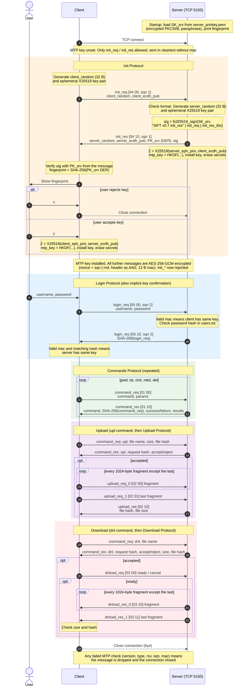
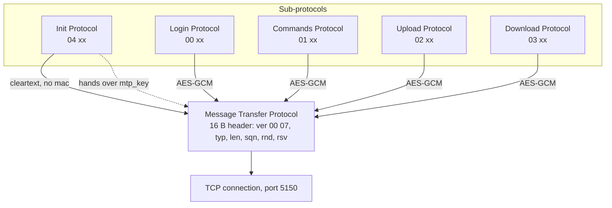
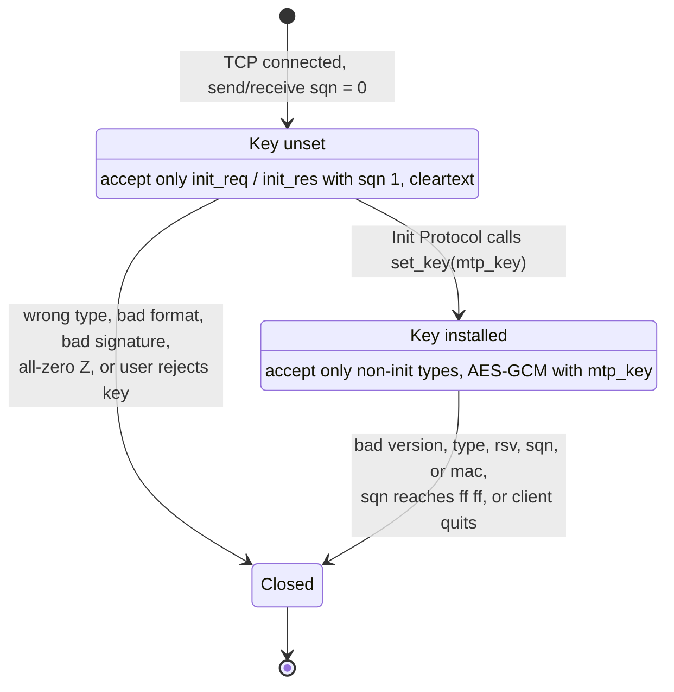
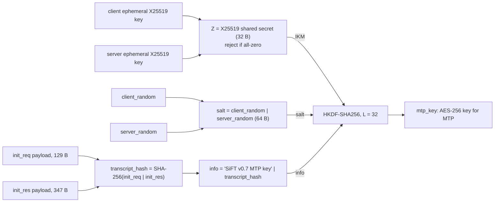

# SiFT v0.7 protocol diagrams

These diagrams summarize the SiFT v0.7 specification (`SiFT v0.7 specification.md`). Sequence numbers (sqn) are shown for the first messages of each direction; they keep increasing by one per message for the whole connection.

## Whole connection

## Sub-protocol layering

## MTP states

## Key derivation

